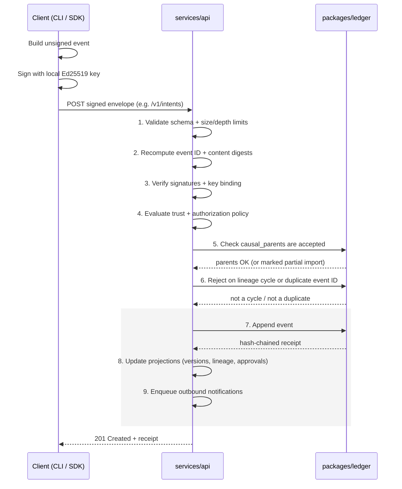
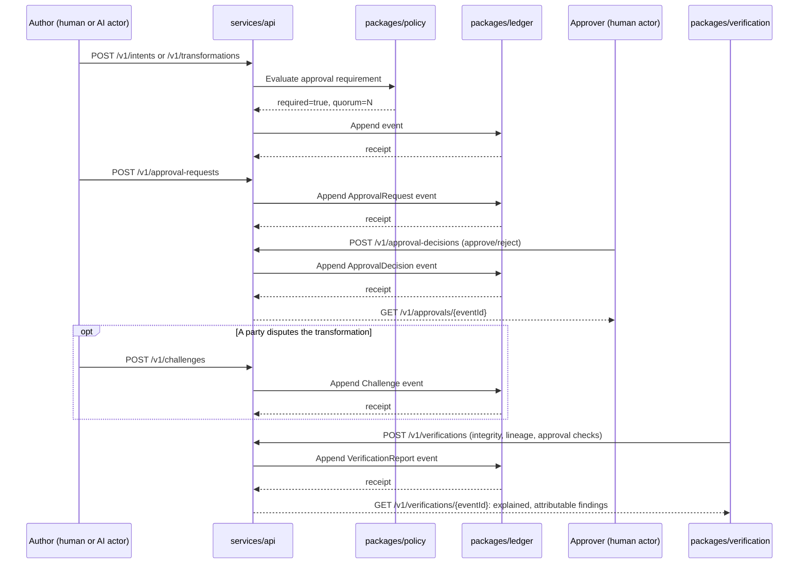
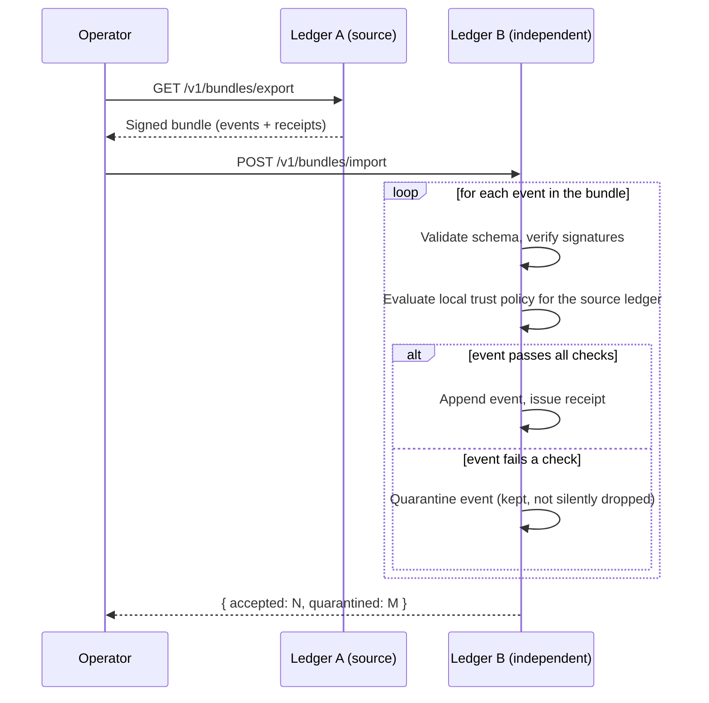

<p align="center">
  
</p>

<h1 align="center">ACT Protocol</h1>
<p align="center"><strong>Accountability and Chain of Transformation</strong></p>

<p align="center">
  <em>An open protocol for recording the provenance of work<br/>
  by people and AI.</em>
</p>

<p align="center">
  <a href="https://github.com/JGalego/ACT-protocol/actions/workflows/ci.yml"></a>
  <a href="LICENSE"></a>
  =22">
  
  
  
</p>

---

ACT is a federated, content-addressed protocol for recording the provenance of work by people, AI systems, and organizations. It links intents and their revisions to artifacts, transformations, approvals, challenges, evidence, and attributed confidence and uncertainty assessments. This repository contains the specification and reference implementation.

Agents, orchestrators, IDEs, code generators, CI/CD systems, and governance tools can implement or consume ACT. The protocol defines records and verification rules; it does not schedule or orchestrate work.

An artifact's records identify its immutable version, the events that produced it, the actors and keys involved, applicable policies and approvals, recorded assumptions and uncertainties, and supporting evidence. Hashes, signatures, receipts, and lineage can be checked independently.

## Status

This is a **1.0.0 release candidate**. The implemented and deferred scope is listed below. See [the roadmap](docs/roadmap.md) for remaining work and [ADR 0001](docs/adr/0001-phase-1-scope-and-deferred-work.md) for the release-scoping decisions.

## Quick Start

Prerequisites: **Node.js 22 LTS** and **pnpm 9+** (`corepack enable`).

```bash
git clone <this-repository>
cd act-protocol
pnpm install

# Regenerate committed schemas and TypeScript types if needed.
pnpm run generate:artifact-types
pnpm run generate:types

# Run formatting, linting, type checks, schema fixtures, and tests.
make verify
```

Run the animated protocol demonstration:

```bash
pnpm run dev:explorer
# -> ACT Explorer at http://localhost:4173
```

The walkthrough follows human intent through an AI proposal, requirements, approval, implementation, tests, a drift finding, a challenge, a revision, and a runtime observation. Use playback, step controls, arrow keys, or the timeline scrubber; select a record to inspect its rationale, assumptions, uncertainty, evidence, lineage, confidence, and envelope. The **Data source** control loads ordered signed envelopes from an ACT `/v1/events` endpoint. Seeded identities and digests are marked as non-production demonstration data.

Start the reference API service (SQLite-backed, local development mode):

```bash
ACT_DEV_MODE=true pnpm --filter @act/api run dev
# -> Fastify listening on :4000; see services/api/openapi/act-v1.yaml
```

Use the `act` CLI against a local embedded workspace:

```bash
cd /somewhere/else
node <path-to-repo>/apps/cli/dist/bin/act.js init --json
node <path-to-repo>/apps/cli/dist/bin/act.js intent create "Ship the thing" --json
node <path-to-repo>/apps/cli/dist/bin/act.js verify --json
```

(After publication: `npm install -g @act/cli && act init`.)

## Architecture Overview

```text
spec/            Normative ACT 1.0 specification (protocol, semantic model,
                  state machines, federation, conformance profiles)
schemas/          JSON Schema 2020-12 for every wire format: events, the
                  DSSE signed envelope, ledger receipts, artifact
                  types, policies, approvals, challenges, federation bundles,
                  each with positive and negative fixtures
packages/
  core/           RFC 8785 canonicalization, SHA-256 digests, UUIDv7 ids,
                  Ajv-based strict validation, schema-generated TS types
  crypto/         Ed25519 keys, DSSE envelope sign/verify, key lifecycle
  ledger/         SQLite-backed, hash-chained, atomic-write-path ledger:
                  cycle detection, idempotency, bounded lineage traversal,
                  quarantine
  policy/         Deterministic approval-requirement and authority-selection
                  evaluation, quorum, separation of duties
  verification/   Integrity/lineage/approval checks; required
                  semantic assessors (structural, AI, human)
  sdk-typescript/ Retrying HTTP client and event builder
services/
  api/            Fastify HTTP service implementing a /v1 subset,
                  with an OpenAPI 3.1 contract and RFC 9457 errors
apps/
  cli/            The `act` command-line tool, operating against a local
                  embedded SQLite workspace
  explorer/       React/Cytoscape animated protocol demonstration and live
                  ledger event viewer, with desktop/mobile browser tests
sdks/
  python/         act-sdk: canonicalization, digests, ids, Ed25519/DSSE,
                  key lifecycle, an event builder, and a retrying HTTP
                  client, checked against packages/core and packages/crypto
                  through conformance/vectors/
conformance/      Frozen cross-SDK vectors and the profile-aware
                  conformance report generator (spec/conformance.md)
deploy/           Dockerfiles, a full Docker Compose stack, and a Helm
                  chart with secure defaults (docs/deployment.md)
examples/         Seeded example applications (product team, competing
                  AI proposals, enterprise OIDC/quorum, open-source
                  federation, safety-critical challenge), each submitting
                  signed envelopes to services/api
docs/             Guides, threat model, versioning, roadmap, ADRs
```

Every package builds independently (`pnpm --filter <name> run build`) and ships its own test suite; `packages/core`, `packages/crypto`, `packages/ledger`, `packages/policy`, and `packages/verification` maintain ≥90% branch coverage, the rest ≥80% (`docs/testing-strategy.md`).

## Transformation Flow

The CLI or TypeScript SDK builds an unsigned event and signs it with a locally held Ed25519 key. The signed envelope goes to `services/api`; event signing remains client-side.

The API validates the schema, recomputes digests, checks signatures and key bindings, evaluates trust and authorization policy, and checks causal parents and lineage. Accepted events receive a hash-chained receipt through `packages/ledger`. `spec/ACT-1.0.md` section 6.1 defines the atomic write path shown below.

`packages/verification` independently checks integrity, lineage completeness, and approval validity, returning separate, attributable findings. `packages/policy` derives approval requirements and quorum from the current policy version and the request.

`services/api/src/__tests__/server.test.ts` exercises key and actor registration, a two-input transformation, approvals, challenges, verification, and bundle transfer between two ledgers using the API handlers and in-memory SQLite.

### Submitting a signed event: the atomic write path

Every write, whether it's an Intent, a Transformation, an Approval, a Challenge, a Verification, or a Policy, goes through this same atomic path (`spec/ACT-1.0.md` §6.1). If any of the first six steps fails, no receipt is issued and no projection is updated.



### Approval, challenge, and verification

Approval requirements and quorum are policy evaluations. Accepted events can be challenged and independently re-verified.



### Federated bundle transfer

Independent ledgers exchange history through signed bundles. The importing ledger verifies the bundle and its events against local trust policy. Events that fail validation are quarantined with rejection reasons and excluded from accepted history.



## What's Built

- The full normative ACT 1.0 specification and semantic model (`spec/`)
- JSON Schemas with positive and negative fixtures
- Canonicalization, digests, ids, and validation (`packages/core`)
- Ed25519 signing, DSSE envelopes, key lifecycle (`packages/crypto`)
- A hash-chained ledger with cycle detection and quarantine, over either SQLite or PostgreSQL behind one `StorageAdapter` contract (`packages/ledger`, ADR 0008)
- Deterministic policy/quorum/authority evaluation (`packages/policy`)
- Integrity, lineage, and approval verification, plus structural, provider-neutral OpenAI-compatible, and human semantic assessors. A deterministic local emulator supports offline testing (`packages/verification`).
- Peer-to-peer HTTP federation between independently hosted ledgers, with informational fork detection and adversarial equivocation detection (`services/api/src/routes/federation.ts`, `spec/federation.md`)
- TLA+ modules covering the write path, concurrent/crashing appends, approval authorization, intent authority, federation, tenant isolation, role assignments, import trust time, and witnessed checkpoints. TLC checks the models and deliberately broken configurations; stateful tests check the API against the same invariants (`formal/`, `make verify-formal`). These are bounded model checks, not proofs of the implementation.
- Production OIDC/JWT bearer-token validation (JWKS signature/issuer/audience/expiry checks via `jose`), backed by a deterministic local OIDC provider for offline testing (`services/api/src/oidc/`, ADR 0006)
- A conformance report generator using frozen vectors and bidirectional SDK signature checks: Core, Cryptographic Integrity, Federation, and SDK profiles claimed (`conformance/`, `spec/conformance.md`)
- TypeScript and Python SDKs (`packages/sdk-typescript`, `sdks/python`), both checked against the same `conformance/vectors/`
- A `/v1` API subset with OpenAPI 3.1 and RFC 9457 errors, including event search/filter, a challenges list, and artifact version-diff (`services/api`)
- The `act` CLI against a local embedded workspace (`apps/cli`)
- An animated ACT Explorer demonstration with playback, timeline scrubbing, evidence inspection, intent-drift visualization, a repository-wide Confidence Heatmap view, and an optional live `/v1/events` data source (`apps/explorer`)
- Non-root Dockerfiles, a Docker Compose stack (API, PostgreSQL, Explorer, OpenTelemetry Collector, and local OIDC dev provider), and a Helm chart with `NetworkPolicy`, `PodDisruptionBudget`, and a pre-install migration Job (`deploy/`, `docs/deployment.md`)
- Seeded examples: the animated walkthrough (`apps/explorer`) and API scenarios covering a product team, competing AI proposals, enterprise OIDC/quorum, open-source federation, and a safety-critical challenge (`examples/`)
- Unit, integration, SDK, and desktop/mobile browser tests (`docs/testing-strategy.md`). Dependency scan results and remaining advisories are documented in `docs/dependency-audit.md`.

## What's Deferred

Go and Rust SDKs, the full operational ACT Explorer conformance profile beyond the implemented animated lineage demo and Confidence Heatmap view, a standalone demo-data seed command, and organizational admission control for key registration. Every item is listed with rationale and a concrete starting point in [`docs/roadmap.md`](docs/roadmap.md).

## Documentation

- [`spec/ACT-1.0.md`](spec/ACT-1.0.md): the normative specification
- [`spec/semantic-model.md`](spec/semantic-model.md), [`spec/state-machines.md`](spec/state-machines.md), [`spec/federation.md`](spec/federation.md), [`spec/conformance.md`](spec/conformance.md)
- [`docs/api-reference.md`](docs/api-reference.md) and [`services/api/openapi/act-v1.yaml`](services/api/openapi/act-v1.yaml)
- [`docs/security-and-privacy-guide.md`](docs/security-and-privacy-guide.md) and [`docs/threat-model.md`](docs/threat-model.md)
- [`docs/versioning.md`](docs/versioning.md), [`docs/testing-strategy.md`](docs/testing-strategy.md), [`docs/standards-adoption.md`](docs/standards-adoption.md)
- [`docs/adr/`](docs/adr/): every non-obvious design decision, with rationale
- [`CONTRIBUTING.md`](CONTRIBUTING.md) and [`GOVERNANCE.md`](GOVERNANCE.md)

## License

[Apache License 2.0](LICENSE).
