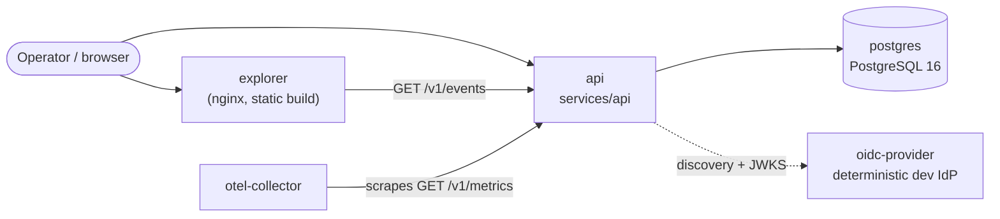

Deployment options under `deploy/` use the API and Explorer's non-root, multi-stage Dockerfiles:

- **`deploy/compose/`**: a local/demo stack using Docker Compose.
- **`deploy/helm/act/`**: a Kubernetes Helm chart.

## Local stack topology

```bash
docker compose -f deploy/compose/docker-compose.yml up --build
```



The Compose stack is for local/demo use. It has fixed development credentials, and the OIDC provider issues tokens on request without authenticating users.

| Service | Purpose |
| --- | --- |
| `postgres` | PostgreSQL 16, the API's storage backend |
| `oidc-provider` | A deterministic, offline OIDC issuer (discovery, JWKS, token endpoint) that exercises the API's production OIDC/JWT path without a paid identity provider |
| `api` | `services/api`, `ACT_STORAGE=postgres`, pointed at both of the above |
| `explorer` | The static Vite build of `apps/explorer`, served by nginx |
| `otel-collector` | Scrapes `GET /v1/metrics` (Prometheus text format) and logs samples through the `debug` exporter |

:::note[Development OIDC provider]

Point `ACT_OIDC_ISSUER` at `oidc-provider` to test discovery, JWKS retrieval, and JWT validation locally. It exercises the production verifier but does not provide a login flow.

:::

## Environment reference

| Variable | Default | Meaning |
| --- | --- | --- |
| `NODE_ENV` | `development` | `production` triggers the fail-closed auth check below |
| `PORT` | `4000` | HTTP port |
| `ACT_STORAGE` | `sqlite` | `sqlite` or `postgres` |
| `ACT_DB_PATH` | `./data/act.db` | SQLite file path (ignored when `ACT_STORAGE=postgres`) |
| `ACT_DATABASE_URL` | — | Required when `ACT_STORAGE=postgres` |
| `ACT_DEV_MODE` | `false` | Enables the local bearer-as-actor-id auth scheme. **Must** be `false` or unset in production; the server refuses to start otherwise |
| `ACT_OIDC_ISSUER` / `ACT_OIDC_AUDIENCE` | — | Required in production (mutually exclusive with `ACT_DEV_MODE`) |
| `ACT_OIDC_JWKS_URI` | discovered from `ACT_OIDC_ISSUER` | Set to skip OIDC discovery |
| `ACT_ADMIN_ACTORS` | — | Comma-separated actor ids (OIDC `sub`) allowed to admit keys, manage federation peers, import bundles, and read the quarantine. An entry `tenant::actor` administers only that tenant; a bare `actor` administers whichever tenant their token names. **Required in production** (the server refuses to start without one); in dev mode, unset means every caller is an administrator |
| `ACT_KEY_REGISTRATION` | `open` in dev mode, `admin` otherwise | `open`: any caller proving possession of a key may register it. `admin`: only administrators may (ADR 0009) |
| `ACT_LEDGER_PRIVATE_KEY` | generated once, stored in the database | Base64 Ed25519 seed for the **default tenant's** receipt-signing key (every other tenant gets its own generated key, stored in the database). Set it to keep the private key out of the database; the server refuses to start if it does not match the key already registered for that database |
| `ACT_REQUIRE_TENANT` | `true` in production, otherwise `false` | Refuse a caller whose credentials name no tenant (OIDC token without the `act_tenant` claim; dev request without `x-act-tenant`) instead of placing them in the `default` tenant (ADR 0010) |
| `ACT_TENANTS` | — | Comma-separated tenant ids that may exist; any other tenant is refused with `403 tenant_not_allowed`. Unset allows any valid tenant id |
| `ACT_MAX_TENANTS` | `1000` | Upper bound on tenants held in memory at once; beyond it new tenants get `503 tenant_limit_reached` |
| `ACT_ALLOW_PRIVATE_PEERS` | `false` (`true` in dev mode) | Permit federation peers on loopback/private/link-local addresses. Leave off in production: it is the SSRF guard |
| `ACT_AUTHORITY_POLICY_FILE` | — | Path to a JSON file `{ "policy": <authority policy> }`: which roles may select or merge an effective intent, and the quorum. Who holds a role is not configuration: it comes from signed accountability assignments (`POST /v1/assignments`, ADR 0011), and a file that still has `actorRoles` stops the server from starting. Without it no one may select or merge an effective intent (`authority_policy_required`) |

A ledger's id and receipt-signing key are stored in its database and shared by replicas. Peers pin that identity out of band via `GET /v1/ledger`. The API resolves peer hosts before each call and refuses redirects, but a DNS-rebinding race remains; restrict outbound traffic to known peers at the network layer.

Production requires OIDC configuration and at least one administrator. `ACT_DEV_MODE=true` is rejected in production. See `services/api/src/server.ts`.

## Tenants

Every tenant is a separate ledger inside the one database: its own ledger id, receipt-signing key, receipt chain, key registry, peers and quarantine (ADR 0010). Tenants are created on first use from the `act_tenant` claim of an authenticated token. An existing single-tenant deployment is simply the `default` tenant: its ledger id, key, history and peers are unchanged, and `ACT_LEDGER_PRIVATE_KEY` still applies to it.

- For more than one tenant, leave `ACT_REQUIRE_TENANT` on (the production default) so a token without the claim is refused rather than placed in `default`, and set `ACT_TENANTS` to the tenants you provision.
- Events must state the caller's tenant (`default` in a single-tenant deployment).
- To share history between tenants, administrators pin each other's ledgers as federation peers and exchange verified bundles, exactly as two separate deployments would. There is no implicit sharing.
- Isolation is logical. Anyone with direct database access sees every tenant, and non-default tenants' signing keys are stored in the database. For stronger separation run a database per tenant (one server each).

## Witnesses

To protect against an operator showing different parties different histories, register independent witnesses per tenant (ADR 0013): an administrator calls `POST /v1/witnesses` with each witness's `key_id` (the fingerprint of its public key) and `public_key`. Each witness runs `witnessStep` from `@act/ledger` on a schedule: it fetches `GET /v1/checkpoint`, proves the history extends the last checkpoint it cosigned (receipts from `GET /v1/receipts`), and files its cosignature with `POST /v1/checkpoints/{size}/witness`. Consumers (auditors, peers) verify with `verifyCheckpoint` against their own witness set and a threshold `k`; with `W` witnesses, fewer than `2k - W` may be corrupt. A tenant with no registered witnesses has no more protection than before. Checkpoints are per tenant.

## Migrations

`services/api`'s `createLedgerContext` applies pending migrations idempotently on every boot, so no separate step is strictly required. A standalone entrypoint (`pnpm --filter @act/api run migrate`) also exists, so a Helm pre-install or pre-upgrade Job can apply migrations once before any API replica rolls out, rather than relying on whichever replica boots first.

## Helm chart

```bash
helm install act deploy/helm/act \
  --set image.repository=<your-registry>/act-api \
  --set existingSecret=act-db-credentials
```

The chart defaults to non-root containers, a read-only root filesystem, dropped capabilities, `NetworkPolicy`, and `PodDisruptionBudget`. It includes a migration Job and supports existing database Secret references for production credentials.

## Verifying without a Docker daemon or live cluster

```bash
make verify-deploy
```

This runs `helm lint` and `helm template`, plus `kubeconform` and `hadolint` when installed. CI installs those tools and also checks Compose configuration with `docker compose ... config`.

:::note[Validation limits]

During development, static checks passed and the HTTP smoke sequence ran against embedded PostgreSQL. That did not validate container builds or a complete Compose deployment. `make verify-integration` requires Docker and runs `scripts/integration-smoke.ts` against the built API with PostgreSQL.

:::
