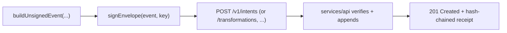

The TypeScript and Python SDKs provide matching functionality. Their tests use shared conformance vectors and verify signatures produced by the other SDK.

| Language | Package | Install |
| --- | --- | --- |
| TypeScript | `packages/sdk-typescript` (`@act/sdk`) | `pnpm add @act/sdk` (workspace) |
| Python | [`sdks/python`](https://github.com/JGalego/ACT-protocol/tree/main/sdks/python) (`act-sdk`) | `pip install -e ".[dev]"` |

The SDKs cover matching layers:

| Layer | TypeScript | Python | Contents |
| --- | --- | --- | --- |
| Canonicalization | `packages/core` | `act_sdk.core` | RFC 8785 canonicalization, SHA-256 digests, UUIDv7 ids |
| Cryptography | `packages/crypto` | `act_sdk.crypto` | Ed25519 keys, DSSE envelope sign/verify, key lifecycle evaluation |
| Event building | `event-builder.ts` | `act_sdk.event_builder` | Unsigned-event construction with protocol defaults filled in |
| HTTP client | `client.ts` | `act_sdk.client` | A thin, retrying client for the ACT reference API |

## Building and submitting an event

Every write to `services/api` follows the same shape regardless of SDK: build an unsigned event, sign it locally, submit the signed envelope. The server never signs on a caller's behalf.

## Cross-language interoperability

`conformance/vectors/generate-vectors.ts` freezes expected canonical bytes, digests, DSSE pre-authentication-encoding bytes, and signatures, ported directly from `packages/core`'s and `packages/crypto`'s own test suites. Every SDK's test suite loads and reproduces the exact same vectors:

- TypeScript: `conformance/vectors/vectors.test.ts`
- Python: `sdks/python/tests/test_vectors.py`

Ed25519 signatures are deterministic per RFC 8032: the same keypair and message produce identical signature bytes. Python's `test_signatures` checks that equality. Separate fixtures under `conformance/interop/` check signature verification in both directions.

:::tip[Porting a new SDK]

Start with `conformance/vectors/` and use `sdks/python` as a porting reference. A new SDK must reproduce the vectors and pass bidirectional signature checks. See the [Roadmap](/roadmap/).

:::

## RFC 8785 porting requirements

Native JSON serialization may differ from RFC 8785 in number formatting and key ordering:

- **Number formatting.** RFC 8785 requires JSON numbers to match ECMAScript's `Number::toString`, which is _not_ what most languages' native float formatting produces. Python's SDK reuses `repr()` only to get the shortest round-tripping decimal digits, then re-formats them with ECMA-262's exact fixed/exponential-notation thresholds. See `act_sdk.core.canonical`'s module docstring for the edge cases: negative zero, the 2^53 precision-loss boundary, subnormals.
- **Key ordering.** RFC 8785 §3.2.3 requires object keys sorted by UTF-16 code unit sequence, not a language's default code-point ordering. Python's SDK sorts by each key's UTF-16BE encoding rather than the raw string, so a key containing a character outside the Basic Multilingual Plane sorts identically across every ACT implementation.
